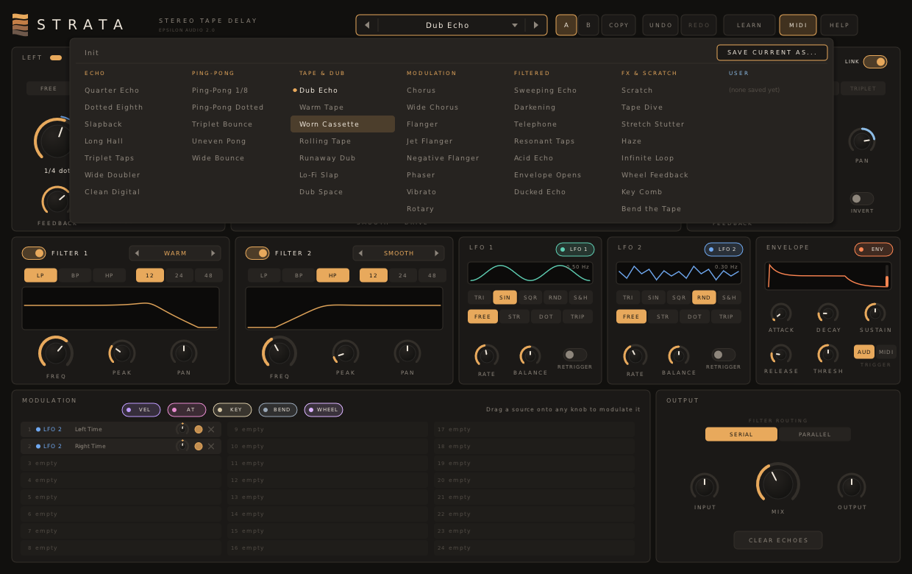
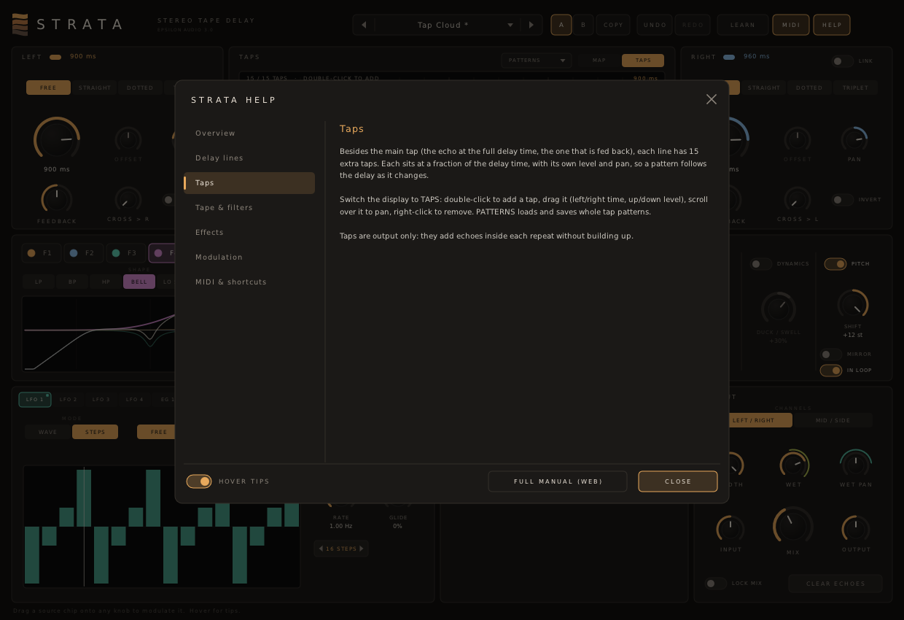

# Strata

**A stereo tape delay plugin for macOS, Windows and Linux (VST3 · AU · CLAP · VST2).**

Part of **[Epsilon Audio](https://github.com/natehouk/epsilon-plugins)**, a family of free, open-source plugins: Monolith, Caldera, Obsidian, Strata, Basalt, Gneiss, Mica, Flint, Granite, Magma, Schist, Slate, Talc, Geode and Malachite.


Strata is a clean-room design with the feature set of FabFilter Timeless 3 (2023). Versions 1 and 2 followed the original Timeless (2006); version 3 follows Timeless 3. It was written from scratch, working only from FabFilter's public product pages, release announcements and contemporary reviews. No FabFilter code, binaries, presets, artwork or trademarks were used.

It is the fourth plugin in a family:
- [Monolith](https://github.com/natehouk/monolith), a synth
- [Caldera](https://github.com/natehouk/caldera), a filter effect
- [Obsidian](https://github.com/natehouk/obsidian), a polysynth
- **Strata**, which puts Caldera's filters inside the feedback loop and shares the Epsilon modulation system (XLFOs, envelopes, followers, XY pads) with Caldera and Magma.

## Download

Get the latest build from [**Releases**](../../releases):

| Platform | File | Contains |
|---|---|---|
| macOS 10.13+ (Apple Silicon + Intel) | `Strata-macos-universal.zip` | VST3, AU, CLAP, manual |
| Windows x64 | `Strata-windows-x64.zip` | VST3, CLAP, VST2, manual |
| Linux x64 | `Strata-linux-x64.zip` | VST3, CLAP, VST2, manual |

### Install

| Platform | Copy | To |
|---|---|---|
| macOS | `Strata.vst3` / `Strata.component` / `Strata.clap` | `~/Library/Audio/Plug-Ins/VST3` / `Components` / `CLAP` |
| Windows | `Strata.vst3` (folder) / `Strata.clap` | `C:\Program Files\Common Files\VST3\` / `CLAP\` |
| Linux | `Strata.vst3` / `Strata.clap` | `~/.vst3/` / `~/.clap/` |

**macOS:** builds are notarized once the project's Apple signing credentials are set up. Until then they are ad-hoc signed; after copying, run:

```
xattr -dr com.apple.quarantine ~/Library/Audio/Plug-Ins/*/Strata*
```

Strata is an audio effect that also accepts MIDI and has a sidechain input. To use the MIDI sources (velocity, key, wheel and so on) or the MIDI-triggered envelopes, route a MIDI track to it; to use the envelope followers' sidechain, route a track to its sidechain. How you do that depends on your DAW.

## Features

**Delay lines (left and right, or mid and side)**
- Each side has its own **time** (1 ms to 4 s), **pan**, **feedback** and **cross-feedback** into the other side.
- **Tempo sync**, per side: **straight, dotted or triplet**, from 1/64 to 2 bars. An **offset** (±50%) pushes or pulls a synced echo off the grid, for swing.
- **Link** makes the right side follow the left side's time settings. **Tap tempo**: click in time.
- **Invert** flips the polarity of what a side feeds back.
- **Input**: stereo, mono, or ping-pong starting on the left or the right line.
- **Mid/side** mode: the lines carry mid and side instead of left and right. **Width**, **wet level** and **wet pan** shape the result.

**Taps**
- Besides the main tap, **15 extra taps** per line, each at a fraction of the delay time with its own level and pan, so patterns follow the delay as it changes. Every tap's time, level and pan can be modulated.
- An interactive **tap editor**: double-click to add, drag for time and level, scroll to pan.
- **Tap patterns**: 13 factory patterns (tresillo, swing, golden spread, cloud...), and save your own.

**Tape, stretch and freeze**
- **Tape**: a time change makes the read head speed up or slow down, so the pitch bends the way real tape does. Turn the time knob quickly, or modulate it, to **scratch**.
- **Stretch**: a time change crossfades to the new time, so the pitch never changes. **Smooth** sets the glide or crossfade time.
- **Freeze** holds the delay lines and loops them; it can be MIDI-learned and modulated.

**Filters (6, inside the feedback loop)**
- Every repeat passes through the filters again, so repeats get darker, thinner, more resonant or more shaped as they fade.
- **Eleven styles:** Smooth, Warm, Monolith (the Monolith synth's filter), Hot, Acid, Raw, Clean, Tube, Gentle, Metal and Hollow.
- **Low / band / high pass, bell, low and high shelf, notch** at **6, 12, 24 or 48 dB/oct**, with **freq**, **peak**, **gain** and **pan** (which offsets the cutoff between the lines).
- **Serial**, **parallel** or **per-channel** routing, and a response display.

**Effects**
- **Drive**: tape-style saturation; feedback above 100% stays under control.
- **Lo-Fi**: sample-rate and bit reduction.
- **Diffuse**: all-pass diffusion, from soft echoes to a reverb-like wash.
- **Dynamics**: duck the echoes while you play, or swell quiet input.
- **Pitch**: ±12 semitones, in the loop (cascading shifts and shimmer) or on the output, with a mirror mode for the right line.

**Modulation** (the Epsilon modulation system, shared with Caldera and Magma)
- **4 XLFOs**: seven waves or a **16-step sequencer** with glide; free or synced (straight, dotted, triplet).
- **2 envelope generators**, triggered by MIDI notes or by the audio input.
- **2 envelope followers**, on the input or the **sidechain**.
- **2 XY pads**, and the **MIDI sources**: velocity, key, mod wheel, pitch bend, aftertouch.
- **50 drag-and-drop slots**: drag a source chip onto any knob; the knob gets a coloured ring with a live dot. Right-click a knob to list everything that moves it. Every slot's amount is itself a destination.
- **Per-source presets** for the XLFOs, envelopes and followers.
- **Classic sources**: Strata 2's two LFOs, envelope and 24 slots are still there, so old projects keep working.
- Delay-time modulation spans ±5 octaves. Small amounts give tape wow and chorus. **Key → Time at −100%** makes the delay a comb filter that plays in tune with the keyboard (see the *Key Comb* preset).


**The echo display** draws every repeat of a single hit on both lines, taps included. It includes feedback, cross-feedback, inversion (shown as hollow dots) and how the loop filters affect each pass, and updates live as the times are modulated.

**Workflow**
- **A/B** with copy, and **undo/redo** for every edit, including new modulation, taps, tap tempo, preset loads and A/B switches.
- **Hover tips** everywhere, a **HELP window**, and a **[full manual](docs/MANUAL.md)** (also in every release zip as `Strata-Manual.html`).
- **MIDI Learn:**
  1. Click **LEARN**.
  2. Click a control, then move a knob or fader on your controller.
  3. Right-click a control to unassign it, or use **Clear all CCs**.

  Assignments are saved with your project.
- **MIDI** switch: turns all MIDI handling off.
- **Clear Echoes** silences everything still in the delay lines. MIDI CC 120 (All Sound Off) does the same.
- **60 factory presets** in eight categories: Echo, Ping-Pong, Tape & Dub, Modulation, Filtered, FX & Scratch, Multi-Tap, and Space & Pitch. **Lock Mix** keeps your mix when you change presets.
- The preset browser **searches** names and categories as you type, and a star keeps a preset in **Favourites**.
- **Save your own presets** as small text files, which load the same on every OS:
  - macOS: `~/Library/Audio/Presets/Epsilon Audio/Strata/`
  - Windows: `%APPDATA%\Epsilon Audio\Strata\Presets\`
  - Linux: `~/.config/epsilon-audio/strata/presets/`
- To delete a user preset, right-click it in the menu, then click it again to confirm.
- **Resizable** window, double-click to **type a value**, **Cmd/Ctrl-click** to reset a control, grab the rim of a large knob to turn it in a circle.





### Compared with FabFilter Timeless 3

| Timeless 3 | Strata 3.0 |
|---|---|
| Dual delay lines with tempo sync and panning | ✓ (1 ms to 4 s; straight, dotted, triplet, with offset; tap tempo, link) |
| Up to 16 delay taps, each controllable and modulatable | ✓ main tap plus 15, with a tap editor and tap patterns |
| Tape-style or time-stretching behaviour on time changes | ✓ |
| Feedback, cross-feedback, phase inversion, ping-pong | ✓ |
| Delay freeze, modulatable | ✓ |
| Up to six multimode filters with filter panning | ✓ eleven original styles, LP/BP/HP/bell/shelves/notch, serial, parallel or per channel |
| Feedback effects: drive, lo-fi, diffuse, dynamics, pitch | ✓ |
| 16-step XLFOs, XY controllers, envelope generators, envelope followers, MIDI sources | ✓ 4 XLFOs, 2 XY pads, 2 EGs, 2 EFs (with sidechain), MIDI |
| Drag-and-drop modulation with visual feedback | ✓ 50 slots, live rings, a floating per-knob slot list |
| Stereo width, mid/side processing | ✓ plus wet level and pan |
| Interactive delay and filter displays | ✓ echo map, tap editor, filter response |
| MIDI Learn, undo/redo, A/B, parameter smoothing | ✓ |
| Factory presets, loads earlier presets | 60, plus your own; loads Strata 1.x and 2.x projects and presets, sounding identical |
| Resizable interface, full-screen mode | Freely resizable interface |
| Delay up to 5 s | Up to 4 s |
| AAX, AudioSuite | Not supported (needs Avid's SDK and signing) |

## Build from source

The plugin is built on [DPF](https://github.com/DISTRHO/DPF):

```
git clone --recursive https://github.com/DISTRHO/DPF.git dpf
make -C plugins/Strata                    # Linux / macOS (macOS also builds the AU)
make -C plugins/Strata WINDOWS=true CC=x86_64-w64-mingw32-gcc CXX=x86_64-w64-mingw32-g++
```

GitHub Actions builds all three platforms on every push. The macOS build is universal. It is signed and notarized when the Developer ID secrets are set (`MACOS_CERT_P12`, `MACOS_CERT_PASSWORD`, `NOTARY_KEY`, `NOTARY_KEY_ID`, `NOTARY_ISSUER`), and ad-hoc signed otherwise. A `v*` tag, or a release published on GitHub, attaches the zips to that release.

## Tests

```
cd tests
for t in features features2 compat fuzz presets modpresets; do g++ -O2 -std=c++17 -I../plugins/Strata $t.cpp -o $t && ./$t; done
g++ -O3 -std=c++17 -I../plugins/Strata bench.cpp -o bench && ./bench
```

- `features`: echo timing, sync/offset/link, feedback, invert, ping-pong, tape vs stretch pitch, filters in the loop, LFO/EG/MIDI/slot-on-slot modulation, runaway safety (the 2.x behaviour)
- `features2`: the 3.0 features: taps, six filters and the new shapes and styles, per-channel routing, lo-fi, diffusion, dynamics, pitch, freeze, mid/side, width, wet level and pan, ping-pong right, XLFOs, envelopes, followers and the sidechain
- `compat`: plays random 2.x settings, MIDI and transport through the 3.0 engine and a frozen copy of the 2.0 engine (`tests/legacy/`); the outputs must match to better than -120 dB (they are identical)
- `fuzz`: random parameters, MIDI and transport at 44.1-192 kHz: finite output, at most 0 dBFS
- `presets`: plays every factory preset and checks its level and tail
- `modpresets`: the source presets and their files
- `bench`: CPU

CPU at 48 kHz on one modern x86 core:

| Worst case | CPU |
|---|---|
| 2.x: stretch mode crossfading, both filters at 48 dB, all 24 classic slots | 3.6% |
| 3.0: six 48 dB filters, all 15 taps, every effect (pitch in the loop), mid/side, all 50 slots | 9.2% |

Release checks:
- Steinberg's VST3 validator passes 47/47.
- The interface is exercised with scripted input, including drag-and-drop modulation, the tap editor and tap patterns, the slot pickers, the source tabs, MIDI Learn, presets, A/B, undo and redo, hover tips and help.

## Source layout

| File | Contents |
|---|---|
| `plugins/Strata/StrataEngine.hpp` | All DSP: delay lines, tape/stretch heads, taps, filters, effects, freeze, classic LFOs and envelope, modulation. Header-only |
| `plugins/Strata/ParamDefs.hpp` | Parameter table, labels, modulation source and destination names, value mapping |
| `plugins/Strata/Presets.hpp` | Factory presets |
| `plugins/Strata/UserPresets.hpp` | User preset files |
| `plugins/Strata/ComponentPresets.hpp` | Factory and user presets for single modulation sources |
| `plugins/Strata/TapPatterns.hpp` | Factory and user tap patterns |
| `plugins/Strata/common/` | Shared Epsilon Audio code (modulation system v2), vendored from epsilon-common |
| `plugins/Strata/Help.hpp` | Hover tip text and in-plugin help pages |
| `plugins/Strata/StrataPlugin.hpp/.cpp` | Plugin wrapper: parameters, programs, MIDI, MIDI Learn, transport, sidechain |
| `plugins/Strata/StrataUI.cpp` | Custom vector interface (NanoVG) |
| `docs/MANUAL.md` | User manual (`Strata-Manual.html` is generated from it with pandoc) |
| `tests/legacy/` | Frozen copy of the 2.0 engine, for the compatibility test |

New parameters are only ever appended, so saved sessions and automation keep working across versions.

## Changelog

- **3.1:** the preset browser searches names and categories as you type, and keeps Favourites.
- **3.0:** 15 extra taps with a tap editor and tap patterns; six filters with five new styles, bell, shelf and notch shapes, 6 dB slopes, gain and per-channel routing; lo-fi, diffuse, dynamics and pitch effects in the loop; freeze; mid/side, width, wet level and pan, lock mix; ping-pong from the right; the Epsilon modulation system (4 XLFOs with step sequencers, 2 envelopes, 2 followers with a sidechain input, 2 XY pads, MIDI sources, 50 slots, per-source presets); a new interface; 17 new factory presets. Sessions and presets from 1.x and 2.x load unchanged and sound identical.
- **2.0:** A/B with copy, undo/redo, hover tips, a help window and a full manual (in every release zip), rim-grab turning on the large knobs. Sessions and automation from 1.x load unchanged.
- **1.0:** First release.

## License

[MIT](LICENSE). Built with [DPF](https://github.com/DISTRHO/DPF) and its bundled NanoVG, which are under the ISC license. `plugins/Strata/ResizeHandle.hpp` comes from DPF's examples and keeps its ISC notice.

"FabFilter" and "FabFilter Timeless" are trademarks of FabFilter Software Instruments. Strata is not affiliated with or endorsed by FabFilter.
