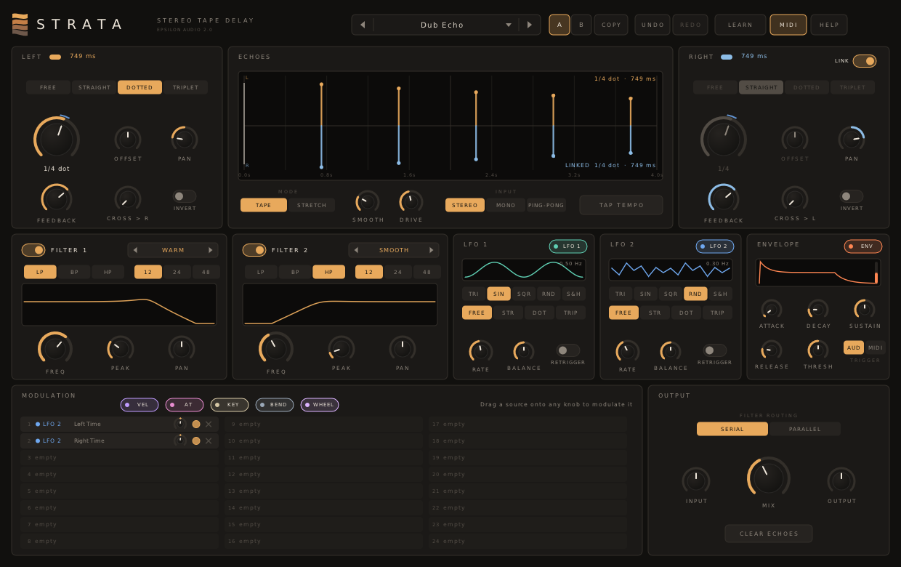
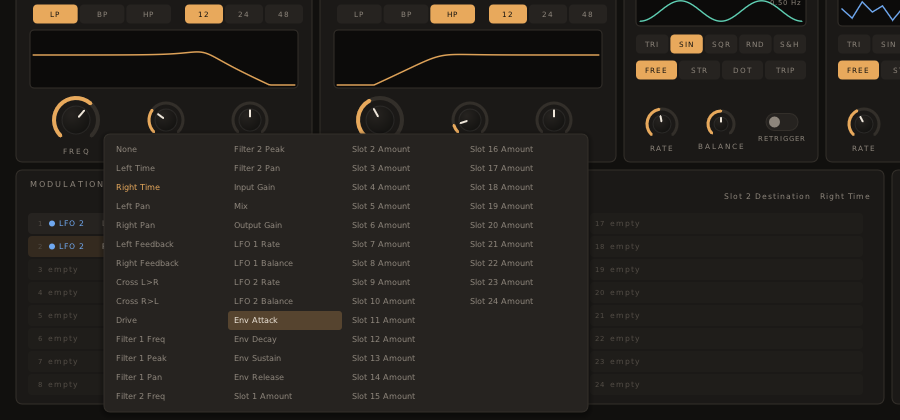

# Strata 3.0 — User Manual

Strata is a stereo tape delay. It has:

- two delay lines, each with feedback and cross-feedback
- 15 extra taps per line, with their own time, level and pan
- tape-style or pitch-free time changes, and freeze
- six filters inside the feedback loop, in 11 styles
- four effects in the loop: lo-fi, diffusion, dynamics and pitch shift
- left/right or mid/side processing
- a modulation system with four XLFOs (wave or step sequencer), two envelopes, two envelope followers, two XY pads and the MIDI sources, and 50 drag-and-drop slots (plus Strata 2's two LFOs, envelope and 24 slots)

Typical uses:

- echoes, slapback and ping-pong delays, in time with the song
- rhythmic multi-tap patterns
- dub and tape delays that bend, saturate and run away
- shimmer, octave and harmonised echoes; diffuse, reverb-like washes
- chorus, flanger, phaser and vibrato
- scratching, freezing and other time effects

Strata runs as VST3, AU, CLAP and VST2 on macOS, Windows and Linux.

**Contents**

1. [Installing](#1-installing)
2. [A quick tour](#2-a-quick-tour)
3. [The delay lines](#3-the-delay-lines)
4. [Taps](#4-taps)
5. [Tape, stretch and freeze](#5-tape-stretch-and-freeze)
6. [The echo display](#6-the-echo-display)
7. [The loop filters](#7-the-loop-filters)
8. [Effects](#8-effects)
9. [Output and channels](#9-output-and-channels)
10. [Modulation](#10-modulation)
11. [Knobs](#11-knobs)
12. [A/B, undo and redo](#12-ab-undo-and-redo)
13. [MIDI](#13-midi)
14. [Presets](#14-presets)
15. [Help and hover tips](#15-help-and-hover-tips)
16. [Recipes](#16-recipes)
17. [Parameter reference](#17-parameter-reference)
18. [Troubleshooting](#18-troubleshooting)
19. [What's new in 3.0](#19-whats-new-in-30)

---

## 1. Installing

Download the zip for your system from the project's **Releases** page and copy the plugin files:

| System | Copy | To |
|---|---|---|
| macOS | `Strata.vst3`, `Strata.component` (AU), `Strata.clap` | `~/Library/Audio/Plug-Ins/VST3`, `.../Components`, `.../CLAP` |
| Windows | the `Strata.vst3` folder, `Strata.clap` | `C:\Program Files\Common Files\VST3\`, `...\CLAP\` |
| Linux | `Strata.vst3`, `Strata.clap` | `~/.vst3/`, `~/.clap/` |

**macOS:** if the build isn't notarized and macOS blocks it, open Terminal and run:

```
xattr -dr com.apple.quarantine ~/Library/Audio/Plug-Ins/*/Strata*
```

Rescan plugins in your DAW. Strata appears under **Epsilon Audio** as an effect.

Strata also accepts MIDI. To use the MIDI sources (velocity, key, wheel and so on) or the MIDI-triggered envelopes, route a MIDI track to it; how depends on your DAW. Strata has a **sidechain** input too: the envelope followers can listen to another track.

**Compatibility.** Projects saved with Strata 1.x and 2.x open unchanged in 3.0 and sound the same, sample for sample, as long as you don't use the new features. Every 2.x control is still there.

---

## 2. A quick tour



- **Header:** the preset browser, **A / B** and **COPY**, **UNDO / REDO**, **LEARN** (MIDI Learn), **MIDI** on/off and **HELP**.
- **Top row:**
  - **LEFT** and **RIGHT** (**MID** and **SIDE** in mid/side mode): each delay line's sync mode, TIME, OFFSET, PAN, FEEDBACK, CROSS and INVERT. RIGHT also has **LINK**.
  - **ECHOES / TAPS:** the echo map or the tap editor, MODE (TAPE or STRETCH), SMOOTH, INPUT, **FREEZE** and **TAP TEMPO**.
- **Middle row:**
  - **Filters:** six filter tabs, style, shape, slope, a response display, FREQ, PEAK, GAIN, PAN and ROUTING.
  - **Effects:** DRIVE, LO-FI, DIFFUSE, DYNAMICS and PITCH.
- **Bottom row:**
  - **Modulation sources:** tabs for LFO 1-4, EG 1-2, EF 1-2, XY 1-2, MIDI and CLASSIC (Strata 2's sources), each with a chip to drag
  - **MODULATION:** the list of connections
  - **OUTPUT:** CHANNELS, WIDTH, WET, WET PAN, INPUT, MIX, OUTPUT, LOCK MIX and **CLEAR ECHOES**
- **Status line** (bottom): the name and value of whatever is under the pointer, and messages.

---

## 3. The delay lines

Strata has a left and a right delay line. Each one has:

- **Sync mode:**
  - **FREE:** **TIME** sets the delay in milliseconds, 1 ms to 4 s.
  - **STRAIGHT**, **DOTTED**, **TRIPLET:** the delay is a note length locked to the host tempo, from 1/64 to 2 bars. TIME then picks the note.
- **OFFSET** (±50%): pushes a synced echo earlier or later than the grid, for swing. It is greyed out in FREE.
- **PAN:** where the side's echoes sit.
- **FEEDBACK:** how much of the side's output feeds back into it. More feedback, more repeats; above 100% the echoes build up, held in check by DRIVE.
- **CROSS:** how much of this side's echo feeds the other side.
- **INVERT:** flips the polarity of what the side feeds back. With short times, a flanger becomes a hollow, negative flanger.

The live time of each side is shown beside its title.

**LINK** (on RIGHT) makes the right side follow the left side's time, sync and offset.

**TAP TEMPO:** click in time. The left side takes the tapped time; the right side keeps its ratio to the left.

**INPUT:**
- **STEREO:** each input channel feeds its own line.
- **MONO:** the sum feeds both lines.
- **P-P L** (ping-pong left): the sum enters the left line only and bounces across through cross-feedback.
- **P-P R** (ping-pong right): the same, starting on the right line.

---

## 4. Taps

Besides the **main tap** (the echo at the full delay time, the only one that is fed back), each line has **15 extra taps**. A tap is another read head:

- its **time** is a fraction of the delay time, 1% to 100%, so the whole pattern follows the delay as it changes (synced, tapped or modulated)
- it has its own **level** (−60 to +6 dB) and **pan** (left takes it from the left line only, right from the right line only)
- taps are output only: they add echoes inside every repeat, but they don't build up

Click **TAPS** above the display to edit them:

- **Double-click** an empty spot to add a tap there (time across, level up).
- **Drag** a tap: left/right is its time, up/down its level. Shift-drag for fine adjustment.
- **Scroll** over a tap to pan it.
- **Right-click** a tap to switch it off. Right-click the **MAIN** bar to switch the main tap off or on (the feedback keeps running either way).
- The line at the top shows the tap under the pointer: its time in % and ms, level and pan.

**PATTERNS** loads a whole tap pattern (the main tap and all 15 taps) without touching the rest of the patch, or saves yours. Factory patterns: Main Only, Even Quarters, Even Eighths, Sixteenths Ramp Up, Sixteenths Fade Out, Tresillo, Swing Eighths, Pre-Echo Cluster, Stereo Scatter, Golden Spread, Cloud, Swell Into Main and Taps Only Triplets. Saved patterns go to a `Taps` folder inside the preset folder (section 14). Right-click a saved pattern to delete it.

Each tap's level, time and pan, and the main tap's level and pan, can be modulated.

---

## 5. Tape, stretch and freeze

**MODE** decides what happens when a delay time changes:

- **TAPE:** the read head speeds up or slows down, so the pitch bends like real tape. Turn TIME quickly, or modulate it, to **scratch**.
- **STRETCH:** the delay crossfades to the new time, so the pitch never changes.

**SMOOTH** sets how fast the change happens: the head's glide in TAPE mode, the crossfade length in STRETCH mode.

**FREEZE** holds what is in the delay lines and loops it forever. While frozen:

- the input no longer enters the lines
- feedback, the filters and the effects are bypassed, so the frozen loop doesn't change or fade
- the taps, the pan and the output controls still work

Release FREEZE to carry on. Freeze fades in and out over about 20 ms. It can be MIDI-learned and modulated (above 50% means frozen): try the mod wheel, or an XLFO in step mode for rhythmic stutters.

---

## 6. The echo display

**MAP** draws every repeat of a single hit on both lines:

- left (or mid) echoes above the centre line, right (or side) echoes below
- feedback, cross-feedback and the loop filters (at 1 kHz) are taken into account
- the extra taps are the thin lines
- hollow dots are inverted repeats

It updates live as the times are modulated. **FROZEN** appears while the lines are frozen.

**TAPS** is the tap editor (section 4).

---

## 7. The loop filters

Six filters sit **inside the feedback loop**, so every repeat passes through them again: repeats get darker, thinner, more resonant or more shaped as they fade.

Click a tab (**F1** to **F6**) to edit that filter; the dot on the tab switches it on or off. Filters 1 and 2 are on by default (low pass 6 kHz and high pass 150 Hz); 3 to 6 are off.

**Styles.** Click the style name to choose:

| Style | Character |
|---|---|
| **Smooth** | Gentle, wide resonance |
| **Warm** | Saturated input, linear filter |
| **Monolith** | The Monolith synth's soft-limited, self-oscillating filter |
| **Hot** | Saturating, screaming peak |
| **Acid** | Resonance thins the bass |
| **Raw** | Hard-clipped, buzzy self-oscillation |
| **Clean** | Linear and transparent; never self-oscillates |
| **Tube** | Asymmetric valve-like drive, mostly even harmonics |
| **Gentle** | Clean, polite and broad |
| **Metal** | Hard-clipped input and feedback; each repeat gets grittier |
| **Hollow** | The band at the cutoff is carved out as the peak rises |

**Controls**
- **Shape:** **LP**, **BP**, **HP** (these follow the style), and the clean EQ shapes **BELL**, **LO SH** (low shelf), **HI SH** (high shelf) and **NOTCH**.
- **Slope:** 6, 12, 24 or 48 dB per octave. For bell and shelf shapes, steeper means narrower. Band pass uses 12 dB at the 6 dB setting; bell and notch become wider.
- **FREQ:** 20 Hz to 20 kHz.
- **PEAK:** resonance; for bell, shelf and notch shapes it narrows the band.
- **GAIN:** boost or cut for bell and shelf shapes, ±24 dB.
- **PAN:** offsets the cutoff between the left and right lines.

The display shows each filter's response (the selected one brighter) and, in white, the combined curve.

**ROUTING**
- **SERIAL:** the loop passes through every filter that is on, 1 to 6.
- **PARALLEL:** each filter processes the loop and their outputs are mixed.
- **PER CHANNEL:** filters 1, 3 and 5 sit in the left (or mid) line, filters 2, 4 and 6 in the right (or side) line; each group is in series. The display shows the two groups' curves.

---

## 8. Effects

DRIVE, LO-FI, DIFFUSE and PITCH (with IN LOOP on) sit **inside the feedback loop**, so they build up with every repeat; DYNAMICS works on the way in and out. Each has an on switch; DRIVE is always there.

- **DRIVE:** tape-style saturation. Each repeat gets a little dirtier, and feedback above 100% stays under control.
- **LO-FI:** lower sample rate and bit depth, a little darker. AMOUNT goes from subtle grit to a crushed, aliased echo.
- **DIFFUSE:** chains of all-pass filters smear each repeat, from softened echoes to a dense, reverb-like wash.
- **DYNAMICS** follows the input level:
  - left of centre **ducks**: the echoes dip while you play and come back up in the gaps (up to about 30 dB)
  - right of centre **swells**: what goes into the lines is evened out, quiet parts up and loud parts down, so soft playing echoes as loudly as hard playing
- **PITCH:** shifts by up to ±12 semitones (SHIFT).
  - **IN LOOP** on: each repeat shifts again, for cascading arpeggios (+7, +12) and shimmer; off: only the output is shifted, so every repeat has the same pitch.
  - **MIRROR:** the right line shifts the other way.
  - The shifter is grain based (40 ms grains): smooth on pads and sustained sounds, grainy on sharp transients.

---

## 9. Output and channels

- **CHANNELS:**
  - **LEFT / RIGHT:** the two lines carry the left and right channels.
  - **MID / SIDE:** the left line carries the mid (centre) and the right line the side (stereo difference). The wet signal is decoded back to left and right. Different times, feedback and filters for mid and side give wide, moving echoes that stay mono-compatible.
- **WIDTH:** the stereo width of what enters the lines: 0% is mono, 100% unchanged. In mid/side mode it scales the side line.
- **WET** (−36 to +12 dB) and **WET PAN:** the level and balance of the echoes, before the mix.
- **INPUT** (±24 dB): the level into the delay lines. Hotter input drives DRIVE and the saturating filter styles.
- **MIX:** dry/wet balance. On a send, use 100%.
- **OUTPUT** (±24 dB): the output level.
- **LOCK MIX:** keeps the mix where it is when you load a preset (MIX LOCKED shows in the preset bar).
- **CLEAR ECHOES:** silences everything still in the delay lines. MIDI CC 120 (All Sound Off) does the same.

---

## 10. Modulation

**Sources.** Pick a tab in the bottom-left panel:

- **LFO 1-4** (XLFOs):
  - **WAVE** mode: sine, triangle, saw up, saw down, square, smooth random, sample & hold, with BALANCE to skew the shape
  - **STEPS** mode: a 16-step sequencer. Draw the steps in the display (Cmd/Ctrl-click resets a step); GLIDE smooths between steps and the stepper sets how many steps play
  - **FREE** runs at RATE in Hz; **SYNC**, **DOTTED** and **TRIPLET** lock to the host tempo and song position
- **EG 1-2** (envelope generators): ATTACK, DECAY, SUSTAIN, RELEASE, triggered by **MIDI** notes or by the **AUDIO** input crossing THRESHOLD.
- **EF 1-2** (envelope followers): follow the **INPUT** or the **SIDECHAIN** level, with ATTACK, RELEASE and GAIN.
- **XY 1-2:** drag the dot; X and Y are separate sources. Great for MIDI Learn or automation.
- **MIDI:** velocity, key (around middle C), mod wheel, pitch bend, aftertouch (channel or polyphonic).
- **CLASSIC:** Strata 2's LFO 1, LFO 2 and envelope, unchanged.

Each XLFO, EG and EF has a **PRESETS** menu: load a ready-made shape, sequence or envelope without touching the rest of the patch, or save your own (right-click a saved one to delete it).

**Drag and drop**
- Drag a source's **chip** onto any knob. A connection is created with a starting amount, and the knob gets a coloured ring.
- Right-click a modulated knob (or click its ring) to list everything that moves it, with amount, bypass and delete.
- Drop a chip onto a connection's amount knob to modulate the amount itself.

**The MODULATION list** shows every connection: source, destination, amount (turn left to invert), bypass and delete. Click the source or destination to change it. Scroll when there are more than eleven.

- There are **50** connections for the new sources. Their destinations are every knob of Strata: delay times, pans, feedback, filters 1-6 (freq, peak, pan, gain), the taps, the effects, freeze, width, wet level and pan, the XLFOs' rates and balance, the envelopes' stages, and every connection's amount.
- The **24 classic** connections (marked 2.X) belong to the CLASSIC sources and reach what Strata 2 could modulate. Old projects keep theirs.

**Ranges.** Delay-time modulation spans ±5 octaves:
- Small amounts give tape wow and chorus.
- **Key → Time at −100%** makes the delay a comb filter that plays in tune with the keyboard (try the *Key Comb* preset).



---

## 11. Knobs

- **Drag** up or down; hold **Shift** for fine adjustment. Connection amounts are finer by default.
- **Grab the rim** of a large knob (TIME, FREQ, MIX, the effects) to turn it in a circle.
- **Mouse wheel** turns a knob.
- **Double-click** to type a value: `375`, `1.5s`, `1.2k`, `L40`, `-6`. **Enter** applies it, **Esc** cancels.
- **Cmd/Ctrl-click** resets to the default.

---

## 12. A/B, undo and redo

- **A / B** hold two complete settings, modulation included. Click the other letter to switch; the first time, B starts as a copy of A.
- **COPY** copies the current setting into the other slot.
- Every edit is an undo step, including new modulation, taps, tap tempo, preset loads and A/B switches. Strata remembers the last 200.
  - Undo: **UNDO**, or Cmd/Ctrl-Z
  - Redo: **REDO**, or Cmd/Ctrl-Shift-Z or Cmd/Ctrl-Y

---

## 13. MIDI

**MIDI Learn**
1. Click **LEARN**.
2. Click a knob, switch, filter tab or FREEZE.
3. Move a knob or fader on your controller.
4. Click **LEARN** again (or press Esc) to finish.

- Right-click a control to unassign it.
- **CLEAR ALL CCs** (in the status line) removes them all.
- Assignments are saved with your project.

**The MIDI button** switches all MIDI handling off: MIDI sources, triggers, retrigger and learned controllers. Use it in hosts that send MIDI to every effect.

---

## 14. Presets

There are 60 factory presets in eight groups, plus your own:

| Group | Presets |
|---|---|
| Echo | Quarter Echo, Dotted Eighth, Slapback, Long Hall, Triplet Taps, Wide Doubler, Clean Digital |
| Ping-Pong | Ping-Pong 1/8, Ping-Pong Dotted, Triplet Bounce, Uneven Pong, Wide Bounce |
| Tape & Dub | Dub Echo, Warm Tape, Worn Cassette, Rolling Tape, Runaway Dub, Lo-Fi Slap, Dub Space |
| Modulation | Chorus, Wide Chorus, Flanger, Jet Flanger, Negative Flanger, Phaser, Vibrato, Rotary, Step Pan Echo |
| Filtered | Sweeping Echo, Darkening, Telephone, Resonant Taps, Acid Echo, Envelope Opens, Ducked Echo, Six-Band Sculpt |
| FX & Scratch | Scratch, Tape Dive, Stretch Stutter, Haze, Infinite Loop, Wheel Feedback, Key Comb, Bend the Tape |
| Multi-Tap | Tresillo Taps, Golden Taps, Tap Cloud, Swell Into Echo, Sixteenth Ramp |
| Space & Pitch | Shimmer, Octave Down Dub, Fifth Cascade, Diffused Wash, Lo-Fi Memory, Ducking Echo, Swelling Echo, Freeze Pad (Wheel), Mid/Side Echo, Sidechain Duck |

**Init** is a plain starting point. *Freeze Pad (Wheel)* freezes when the mod wheel passes halfway; *Sidechain Duck* ducks the echoes with a sidechain signal.

**Browsing**
- Click the preset name to open the browser.
- **◀ ▶**, or the mouse wheel over the name, step through factory and user presets.
- **Search:** with the browser open, just type: the list narrows to presets whose name or category matches. Backspace edits, Esc clears the search (and then closes the browser).
- **Favourites:** click the star at the right of any preset to add it to the FAVOURITES column; click again to remove it. Favourites are kept in `favourites.txt` in your presets folder.
- A `*` after the name means you have changed the setting since loading it.
- **LOCK MIX** (in OUTPUT) keeps your mix when you load a preset.

**Your own presets**
- **SAVE CURRENT AS…** stores your own presets, in one of these folders:
  - macOS: `~/Library/Audio/Presets/Epsilon Audio/Strata`
  - Windows: `%APPDATA%\Epsilon Audio\Strata\Presets`
  - Linux: `~/.config/epsilon-audio/strata/presets`
- Source presets and tap patterns go in the `LFO`, `Envelope`, `Follower` and `Taps` folders inside it.
- Preset files are plain text and work on every system. Presets saved with Strata 2 load unchanged.
- To delete one, right-click it in the browser and click again to confirm.

---

## 15. Help and hover tips

- Rest the pointer on any control, chip, display or button to see what it does and its current value.
- **HELP** opens the in-plugin pages. The switch at the bottom of the help window turns hover tips on or off.
- **FULL MANUAL (WEB)** opens this manual.

---

## 16. Recipes

- **Dotted-eighth echo:** LEFT DOTTED 1/8, LINK on, FEEDBACK 35%, filter 1 LP around 4 kHz, MIX 25%.
- **Ping-pong:**
  - INPUT P-P L
  - both sides STRAIGHT 1/8, FEEDBACK 0
  - CROSS > R and CROSS > L around 60%
- **Dub delay:**
  - TAPE mode, DRIVE 40%
  - FEEDBACK 80-100%, filter 1 HP around 300 Hz, filter 2 LP around 3 kHz
  - ride FEEDBACK above 100% for a moment
- **Rhythmic taps:** sync both sides to 1/2 or 1 bar, TAPS view, PATTERNS > Tresillo or Swing Eighths; lower FEEDBACK so the pattern doesn't smear.
- **Shimmer:** FREE about 450 ms, FEEDBACK 60%, PITCH on at +12 with IN LOOP, DIFFUSE 70%, filter 1 LP around 7 kHz.
- **Octave-down dub:** PITCH −12 IN LOOP, Warm filter style, a little DRIVE.
- **Ducked echo:** DYNAMICS on, turned to −60% or so: the echoes stay out of the way while you play.
- **Sidechain duck:** EF 1 on SIDECHAIN, drag its chip onto WET with a negative amount, and route the kick or the vocal to Strata's sidechain.
- **Freeze pad:** DIFFUSE on, drag the mod wheel (MIDI tab) onto FREEZE at +100%; push the wheel up to hold the cloud and play over it.
- **Mid/side:** CHANNELS MID / SIDE, a short time on MID and a longer one on SIDE, more feedback on SIDE: wide, mono-safe echoes.
- **Chorus:**
  - FREE, TIME about 15 ms, FEEDBACK 0, MIX 50%
  - an XLFO SIN at about 0.8 Hz onto Left Time and Right Time with small, opposite amounts
- **Flanger:** TIME about 3 ms, FEEDBACK 60%, a slow LFO onto TIME. INVERT for the negative flanger.
- **Scratch:** TAPE mode, SMOOTH short; drag TIME quickly, or modulate it with a fast LFO.

---

## 17. Parameter reference

Every control is automatable. New parameters are only ever added at the end, so sessions and automation keep working across versions.

- **Each side:**
  - Time (1 ms-4 s), Sync (Free, Straight, Dotted, Triplet), Note (1/64-2 bars), Offset (±50%)
  - Pan, Feedback (0-110%), Cross-feedback (0-110%), Invert
- **Link.**
- **Echo:** Mode (Tape, Stretch), Smoothing (1 ms-2 s), Input (Stereo, Mono, Ping-Pong, Ping-Pong R), Freeze.
- **Taps:** Main Tap On, Level (−60 to +6 dB), Pan; Tap 1-15 On, Time (1-100% of the delay), Level, Pan.
- **Each filter (1-6):**
  - On, Style (Smooth, Warm, Monolith, Hot, Acid, Raw, Clean, Tube, Gentle, Metal, Hollow)
  - Type (Low Pass, Band Pass, High Pass, Bell, Low Shelf, High Shelf, Notch), Slope (6, 12, 24, 48 dB/oct)
  - Freq (20 Hz-20 kHz), Peak, Pan, Gain (±24 dB)
- **Filter Routing:** Serial, Parallel, Per Channel.
- **Effects:** Drive; Lo-Fi On, Lo-Fi; Diffuse On, Diffuse; Dynamics On, Dynamics (±100%); Pitch On, Pitch (±12 st), Pitch Mirror, Pitch In Feedback.
- **Output:** Channel Mode (Left/Right, Mid/Side), Stereo Width, Wet Level (−36 to +12 dB), Wet Pan, Input Gain (±24 dB), Mix, Output Gain (±24 dB), Lock Mix.
- **XLFO 1-4:** Mode, Wave, Rate, Sync, Division, Balance, Glide, Steps, Step 1-16.
- **EG 1-2:** Attack, Decay, Sustain, Release, Trigger (MIDI, Audio), Threshold.
- **EF 1-2:** Attack, Release, Gain, Source (Input, Sidechain).
- **XY 1-2:** X, Y.
- **50 modulation slots,** each with Source, Destination, Amount (±100%) and Bypass.
- **Classic (Strata 2):**
  - LFO 1 and 2: Wave (Triangle, Sine, Square, Random, Sample & Hold), Balance, Sync, Rate (0.01-50 Hz), Division, MIDI Retrigger
  - Envelope: Attack, Decay, Sustain, Release, Threshold (−60 to 0 dB), Trigger (Audio, MIDI)
  - 24 modulation slots, each with Source, Destination, Amount and Bypass
- **MIDI:** on/off.

Strata also reports a few output values that hosts may list (the live delay times, the envelope level and a MIDI Learn message); they are for the interface.

---

## 18. Troubleshooting

- **Strata doesn't appear in my DAW.** Check the install folders above and rescan plugins. On macOS, run the `xattr` command from section 1.
- **The echoes don't follow the tempo.** Choose STRAIGHT, DOTTED or TRIPLET instead of FREE.
- **The feedback runs away.** Lower FEEDBACK or CROSS below 100%, raise DRIVE to tame it, or click CLEAR ECHOES. PITCH in the loop with high feedback builds up quickly.
- **Changing the time bends the pitch.** That's TAPE mode; choose STRETCH for pitch-free changes.
- **The taps don't build up.** They are output only; only the main tap is fed back.
- **No sound after FREEZE.** Freeze holds what was in the lines when you pressed it; if they were empty, so is the loop. Release it, play, and freeze again.
- **The follower on SIDECHAIN does nothing.** Route a track to Strata's sidechain input in your DAW.
- **MIDI sources or the MIDI trigger do nothing.** Route MIDI to Strata in your DAW, and check that the MIDI button is on.
- **Hover tips get in the way.** Turn them off with the switch at the bottom of the HELP window.
- **Latency:** Strata has none.
- **CPU:** about 4% of one core at 48 kHz in Strata 2's worst case, about 9% with six 48 dB filters, all taps, every effect and 50 connections running (measured on one modern x86 core).

---

## 19. What's new in 3.0

- 15 extra taps per line, with a tap editor and tap pattern presets
- six filters (was two) with five new styles (Clean, Tube, Gentle, Metal, Hollow), bell, shelf and notch shapes, 6 dB slopes, a gain control, and per-channel routing
- effects in the loop: lo-fi, diffusion, dynamics (duck or swell) and a pitch shifter
- freeze
- mid/side processing, stereo width, wet level and pan, lock mix
- ping-pong from the right line
- the new modulation system: four XLFOs with step sequencers, two envelopes, two envelope followers (with sidechain), two XY pads and the MIDI sources, 50 slots, per-source presets, a floating list of what modulates each knob
- a sidechain input
- 17 new factory presets
- 2.x projects and presets open and sound exactly as before
